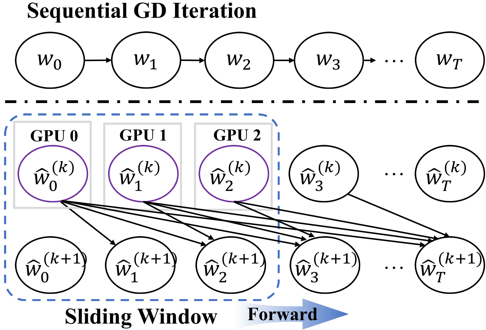

# 🚀 EIPO: Efficient Inter‑Step Parallel Optimization

<div align="center">


[](https://www.python.org/)
[](https://pytorch.org/)
[](LICENSE)

**Official implementation of *EIPO: Efficient Inter‑Step Parallel Optimization***  
</div>

**EIPO** recasts the sequential gradient‑descent trajectory of  modern optimizers (SGD, Adam, AdamW) as the unique root of a nonlinear system.  
It then solves this system with a **memory‑efficient Quasi‑Newton preconditioner** built directly from the optimizer’s momentum buffers.  
The resulted **inter‑step parallelism** that reduces optimizer iterations by up to **21×** and wall‑clock time by up to **4.6×** – with matching model quality, memory footprint, and total token consumption.


---

## 📁 Project Structure

```
EIPO/
├── figures/
│   └── EIPO.png                 # Visual overview of the method
├── cv.py                        # CIFAR‑10 classification (ResNet50, ViT, CNN)
├── diffusion.py                 # LSUN Church diffusion (UNet/DDPM/DDIM)
├── llm.py                       # WikiText‑2 language modeling (GPT‑2, Llama, Qwen, Gemma, GPT‑J)
├── README.md                    # This file
└── requirements.txt             # Python dependencies
```

---

## ⚙️ Installation

Create a Python 3.10+ environment and install dependencies:

```bash
pip install -r requirements.txt
```


## 📦 Datasets

All datasets are automatically downloaded except LSUN Church (manual, see [LSUN](https://www.yf.io/p/lsun)).  

| Dataset         | Used by          | Auto‑download |
|----------------|------------------|:-------------:|
| WikiText‑2      | `llm.py`         | ❌ (manual)           |
| CIFAR‑10        | `cv.py`          | ✅            |
| LSUN Church     | `diffusion.py`   | ❌ (manual)   |

For LSUN Church, place images in `./dataset/church_outdoor_images/` or adjust `--data_folder`.

---

## 🧪 Reproducing Results (Tables & Figures)

> 📌 **All commands** assume you are inside the `EIPO/` directory.  
> Use `--training_mode serial` for baseline (sequential) runs, and `--training_mode parallel` for EIPO.

### 📊 Table 3 – Language Modeling (GPT‑2, Llama‑3.2‑1B) on WikiText‑2  
**File:** `llm.py`

#### GPT‑2 (124M, pre‑trained init)

```bash
# Serial AdamW baseline
python llm.py --local_model_dir ./gpt2 --modelscope_name gpt2 --max_steps 5000 \
    --batch_size 112 --learning_rate 6e-5 --training_mode serial --optimizer_type adamw \
    --lr_scheduler_type constant

# EIPO (AdamW) – 7× fewer iterations
python llm.py --local_model_dir ./gpt2 --modelscope_name gpt2 --max_steps 5000 \
    --batch_size 112 --learning_rate 6e-5 --threshold 1e-4 --ema_decay 0.999 \
    --training_mode parallel --gamma 0.99 --P 7 --optimizer_type adamw --lr_scheduler_type constant
```

For SGD or Adam, change `--optimizer_type`. For Llama‑3.2‑1B use `--modelscope_name Llama-3.2-1B`, `--batch_size 30`, `--learning_rate 1e-5`, and a cosine scheduler.  
👉 **Full commands:** See **Listing 1&2** in the paper appendix.

---

### 🖼️ Table 4 – Image Classification (ResNet50, ViT) on CIFAR‑10  
**File:** `cv.py`

#### ResNet50 (GroupNorm)

```bash
# Serial Adam
python cv.py --dataset cifar10 --model_name resnet50 --max_steps 100000 \
    --batch_size 2048 --learning_rate 5e-5 --training_mode serial --optimizer_type adam \
    --lr_scheduler_type cosine --warmup_steps 10000

# EIPO Adam – 6.8× speedup
python cv.py --dataset cifar10 --model_name resnet50 --max_steps 100000 \
    --batch_size 2048 --learning_rate 5e-5 --threshold 0.1 --ema_decay 0.999 \
    --training_mode parallel --gamma 0.01 --P 7 --optimizer_type adam \
    --lr_scheduler_type cosine --warmup_steps 10000
```

For ViT, use `--model_name vit`. For SGD, use `--max_steps 240000` and adjust `--gamma`.  
👉 **Full commands:** See **Listing 8&9**.

---

### 🎨 Table 1 – Diffusion Training (LSUN Church, UNet/DDPM)  
**File:** `diffusion.py`

```bash
# Serial Adam baseline
python diffusion.py --results_folder diffusion_v2_serial --dataset lsun_church \
    --model_name unet --training_mode serial --lr_scheduler_type cosine \
    --warmup_steps 10000 --save_and_sample_every 10000

# EIPO Adam
python diffusion.py --results_folder diffusion_v2_parallel --dataset lsun_church \
    --model_name unet --threshold 1e-6 --EIPO_ema_decay 0.99 --training_mode parallel \
    --P 7 --gamma 0.01 --lr_scheduler_type cosine --warmup_steps 10000 \
    --save_and_sample_every 10000
```

Compute FID:

```bash
python sweep_fid.py --results_folder diffusion_v2_parallel --data_folder ./dataset/church_outdoor_images \
    --milestones 10000 50000 100000 ... --csv_name parallel_fid.csv \
    --batch_size 512 --num_samples 50000
```

👉 **Full commands:** See **Listing 10&11**.

---

### 🧠 Table 5 – Large‑scale LLMs (Gemma‑2B, Qwen1.5‑4B, Qwen2.5‑3B, GPT‑J‑6B)  
**File:** `llm.py`

Example for Gemma‑2B:

```bash
# Serial
python llm.py --local_model_dir ./gemma-2b --modelscope_name gemma-2b \
    --max_steps 1000 --batch_size 24 --learning_rate 1e-5 --training_mode serial \
    --optimizer_type adamw --lr_scheduler_type cosine

# EIPO
python llm.py --local_model_dir ./gemma-2b --modelscope_name gemma-2b \
    --max_steps 1000 --batch_size 24 --learning_rate 1e-5 --threshold 1e-1 --ema_decay 0.999 \
    --training_mode parallel --P 7 --gamma 0.2 --optimizer_type adamw --lr_scheduler_type cosine
```

---

### ⚡ Table 2 – Inter-Step vs. Data Parallelism (GPT‑2)  
**File:** `llm.py`

| Method               | `--training_mode` argument |
|----------------------|-----------------------------|
| EIPO (inter-step parallel) | `parallel`                  |
| Naive data parallel  | `naive_dp`                  |
| PyTorch DDP          | `ddp`                       |
| DeepSpeed ZeRO‑3     | `deepspeed `       |

Example:

```bash
# EIPO
python llm.py ... --training_mode parallel --P 21 --threshold 0.1

# DDP
python llm.py ... --training_mode ddp
```

👉 **Full commands:** See **Listing 12**.

---

### 📊 Figure 4 – Sensitivity (Window Size, Batch Size, LR, γ)  
**File:** `llm.py` (GPT‑2)

| Parameter       | Flag            | Values                    |
|----------------|-----------------|---------------------------|
| Window size    | `--P`           | 7, 14, 21, 28             |
| Batch size     | `--batch_size`  | 52, 72, 92, 112           |
| Learning rate  | `--learning_rate` | 1e‑5, 1e‑4, 1e‑3        |
| Damping γ      | `--gamma`       | 0.0, 0.1, 1.0, 10.0       |

👉 **Full commands:** See **Listings 4–7**.

---

### 📉 Figure 5 – Sensitivity to Tolerance δ and EMA Decay λ  
**File:** `cv.py` (CNN on CIFAR‑10)

Vary `--threshold` (δ) from `1e-7` to `0.1` and `--ema_decay` (λ) from `0.9` to `0.9999`.

```bash
python cv.py --dataset cifar10 --model_name cnn --max_steps 60000 --batch_size 4096 \
    --learning_rate 1e-3 --training_mode parallel --threshold 1e-5 --ema_decay 0.999 ...
```

---

## 🖥️ Hardware Requirements

- **8× NVIDIA A100** GPUs and **8× NVIDIA H20**  
---

## 🙏 Acknowledgements

We thank the Area Chairs, Program Committee, and the anonymous reviewers for their valuable time and constructive feedback.

We thank the open‑source community for datasets, models, and libraries that made this work possible.

